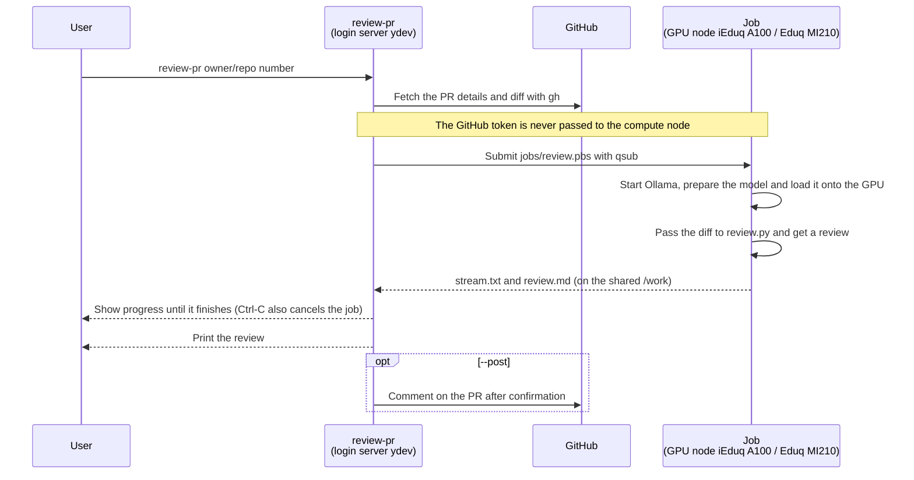

# mikawa-pbl-localllm-review

A CLI that reviews GitHub pull requests with a local LLM running on the GPUs of the Toyohashi University of Technology HPC.
It works on both `iEduq` (NVIDIA A100) and `Eduq` (AMD MI210).

```bash
./review-pr TechnoTUT/dmxctl 3
./review-pr https://github.com/TechnoTUT/dmxctl/pull/3
```

## How it works



Results are kept in `runs/<owner>_<repo>/pr<number>-<datetime>/`.

| File | Contents |
|---|---|
| `review.md` | The review |
| `pr.json` / `pr.diff` | PR details and diff |
| `progress` | Job progress |
| `stream.txt` / `stream.txt.stat` | Output while generating / stage and token count |
| `job.log` / `ollama.log` | Job and Ollama logs |

## First-time setup (once, on the login server)

```bash
# Log in to gh (installed in ~/.local/bin without admin rights)
gh auth login

# Extract Ollama into /work/$USER/llm (about 1.4GB)
mkdir -p /work/$USER/llm/ollama && cd /work/$USER/llm
curl -fL -o ollama-linux-amd64.tar.zst \
  https://github.com/ollama/ollama/releases/download/v0.40.13/ollama-linux-amd64.tar.zst
tar --use-compress-program=zstd -xf ollama-linux-amd64.tar.zst -C ollama

# To also use Eduq (AMD MI210), extract the AMD (ROCm) libraries into the same place (about 1GB)
curl -fL -o ollama-linux-amd64-rocm.tar.zst \
  https://github.com/ollama/ollama/releases/download/v0.40.13/ollama-linux-amd64-rocm.tar.zst
tar --use-compress-program=zstd -xf ollama-linux-amd64-rocm.tar.zst -C ollama
```

The model (default `flint:40b`, about 23GB) is pulled into `/work/$USER/llm/models` during the first job and reused afterwards.

## Usage

```
review-pr [options] <owner/repo> <PR number>
review-pr [options] <PR URL>
review-pr [options] <owner/repo>  (choose the PR and the rest interactively)
review-pr                       (no arguments: choose everything interactively)

  -i, --interactive    Choose interactively (values given as arguments or options become the defaults)
  -q, --queue QUEUE    Queue to use: iEduq (NVIDIA A100, default) or Eduq (AMD MI210)
  -g, --gpus N         Number of GPUs (1 on iEduq, 1-2 on Eduq; default 1)
  -H, --host NODE      Pin the node (e.g. yind01)
  -m, --model MODEL    Ollama model (default flint:40b)
  -o, --output FILE    Also save the review to FILE
      --post           Post the review as a PR comment (asks for confirmation first)
      --no-wait        Exit right after submitting the job
      --quiet          Show only the status line, not the output while generating
      --new-job        Run in a new job even if a review server is running
      --server         Run on the review server (error if none is running)
      --start-server   Start a review server if none is running (up to 8 hours), wait for the model to load, then send the request
```

Progress goes to stderr and the review body to stdout, so `> review.md` saves just the body.

### Interactive mode

Run without arguments, enter the repository, then choose each of the following with the arrow keys or Vim keys.
Give only the repository, as in `./review-pr TechnoTUT/dmxctl`, to start from choosing the PR.

- PR (list of open PRs; choose "Other" and enter a number to pick a merged PR or the like)
- Queue and GPUs (iEduq × 1, Eduq × 1, Eduq × 2)
- Model (list of pulled models; choose "Other" to enter a name)
- Node (automatic or pinned), whether to post to the PR, whether to wait until it finishes

| Key | Action |
|---|---|
| `↑` / `k`, `↓` / `j` | Move up / down |
| `g` / `G` | Go to first / last |
| `1`-`9` | Go to that option |
| Enter | Select |
| `q` (or Ctrl-C) | Cancel |

At the end it shows the equivalent command with arguments and runs it after confirmation.
With `-i`, interactive mode starts with the values given as arguments or options as defaults.

```
$ ./review-pr
Repository (owner/repo): TechnoTUT/dmxctl
Pull request: #4  リファクタリング: engine.rs / ui_map.rs の分割と clippy 対応  (dodolia907, +2661/-2428)
Queue / GPU  (↑↓ / j k to move, Enter to select, q to cancel)
  iEduq  NVIDIA A100 80GB x1 (yind00/01)
> Eduq   AMD MI210 64GB x1 (ysnd00/01)
  Eduq   AMD MI210 64GB x2 (ysnd00/01; for models over 64GB, no speedup for models that fit on one)
```

### Display while running

While waiting for the job, a Claude Code-style status line sits at the bottom of the screen and the model's output scrolls above it.
The thinking is shown in a dim color and the review body in the normal color.

```
── thinking ──
We need to review the CI workflow changes. The mac and windows jobs only run on ...
Deliberating… (2m 41s · ↓ 3.4k tokens · thinking · ctrl+c to cancel)  so a push to a branch never builds
```

- The status line shows the elapsed time, the number of tokens generated and the stage (queued → starting ollama → loading model onto gpu → reading diff → thinking → writing review), followed by the line being generated
- A bright cyan band sweeps across the leading word (Deliberating, etc.). The word changes with each stage
- Since the body has already scrolled by, only the save location is shown at the end. When stdout is redirected, the body is written there
- With `--quiet`, the output while generating is not shown, only the status line
- When not on a terminal (e.g. when saving to a log), stage changes are printed one per line instead of the animation
- The CLI's messages are in English. The review body is in Japanese (specified in the prompt in `review.py`)

### Queues

| Queue | Nodes | GPU | Per-job limits |
|---|---|---|---|
| `iEduq` | yind00, yind01 | NVIDIA A100 80GB × 1 | 8 CPUs, 64GB memory, 8 hours. About 56 tokens/s with flint |
| `Eduq` | ysnd00, ysnd01 | AMD Instinct MI210 64GB × 2 | 8 CPUs, 64GB memory, 2 GPUs, 8 hours. About 30 tokens/s with flint |

- Each queue allows one running job per user. The two queues are separate, so you can run one job on iEduq and one on Eduq at the same time
- If a job goes on hold (H), `review-pr` cancels it and exits. The node may be unhealthy, so pin another node with `-H`

## Review server (keep the model loaded for consecutive reviews)

Running `review-pr` as a new job each time takes about 1 min 45 s on iEduq (about 35 s on Eduq) from job start
through starting Ollama, detecting the GPU and loading the model, on top of waiting in the queue.
`review-server start` launches a resident job (up to 8 hours) that keeps the model on the GPU
and reviews requests from `review-pr` in turn. From the second request on, generation starts within seconds (5.5 s measured on 2026-11-03).

```bash
./review-server start              # 8 hours on iEduq. Waits until the model is loaded (about 1-2 min)
./review-server start -q Eduq -t 4 # 4 hours on Eduq
./review-server status             # Running servers, time left, running and queued requests
./review-server stop               # Stop after the running review finishes (--now to stop immediately)

./review-pr TechnoTUT/dmxctl 3     # Sends the request to the server automatically if one is running
./review-pr --new-job TechnoTUT/dmxctl 3   # Runs in a new job even if a server is running
./review-pr --start-server TechnoTUT/dmxctl 3   # Starts a server if none is running, then sends the request (choose the queue with -q)
```

- Requests are processed one at a time. While waiting, the status line shows how many are ahead, e.g. "waiting for the server (1 ahead)"
- In interactive mode, a running server is the first option under "Where to run".
  Choosing "Start a review server (up to 8h)" lets you pick a queue with no server running to start one (same as `--start-server`)
- Pressing Ctrl-C while `--start-server` is waiting for the server cancels only that request. The server keeps starting
- The server and `review-pr` communicate through files on the shared `/work` (`server/<ID>/`). No port is opened,
  so other users cannot use it
- If the requested model differs from the loaded one, the server switches to that model
- The server rejects requests that would not fit in the remaining time, and `review-pr` automatically falls back to a new job
- The server counts as a job, so while it runs, other jobs on the same queue wait their turn
  (use `--new-job` on the other queue)

## Choosing a model

Results of checking each model's findings against the diff of PR #3 (a CI change, 99-line diff) (2026-11-03, iEduq):

| Model | Correct findings | Wrong findings | Time |
|---|---|---|---|
| qwen3-coder:30b | 0 | 2 | 19 s |
| qwen3.8:27b-q8_0 | 3 | 0 | 243 s |
| muse-glimmer:30b-q8_0 | 4 | 2 | 181 s |
| **flint:40b** (default) | **5** | **0** | 274 s |
| ornith-1.5:35b | 5 | 1 | 412 s |

This compares only one PR, so it is worth comparing on other PRs too. To review the same PR with another model, pass it with `-m`:

```bash
./review-pr -m qwen3.8:27b-q8_0 TechnoTUT/dmxctl 3
```

## Limitations and caveats

- The diff is truncated at about 160,000 characters (context length 131072 tokens). Files after the cut are not reviewed
- Reviews may contain mistakes. When posting with `--post`, check the content before posting
- gh credentials are used only on the login server (compute nodes receive only the PR details and diff)

## Files

| File | Role |
|---|---|
| `review-pr` | The CLI. Fetches the PR, submits the job (or sends a request to the server) and waits, shows and posts the result |
| `review-server` / `jobs/server.pbs` | Start, check and stop the review server / the resident job |
| `jobs/server_common.sh` | Listing servers and checking whether they are alive |
| `motd` | Banner shown when `review-pr` starts (only on a terminal) |
| `jobs/ui.sh` | Color settings and interactive prompts and menus (shared by `review-pr` and `review-server`) |
| `review.py` | Sends the prompt to Ollama and gets the review (standard library only) |
| `jobs/review.pbs` | The review job |
| `jobs/ollama_env.sh` | Starting Ollama, pulling the model and confirming it is loaded onto the GPU |
| `jobs/qsub_common.sh` | qsub arguments for each queue (container, GPU count, node) |
