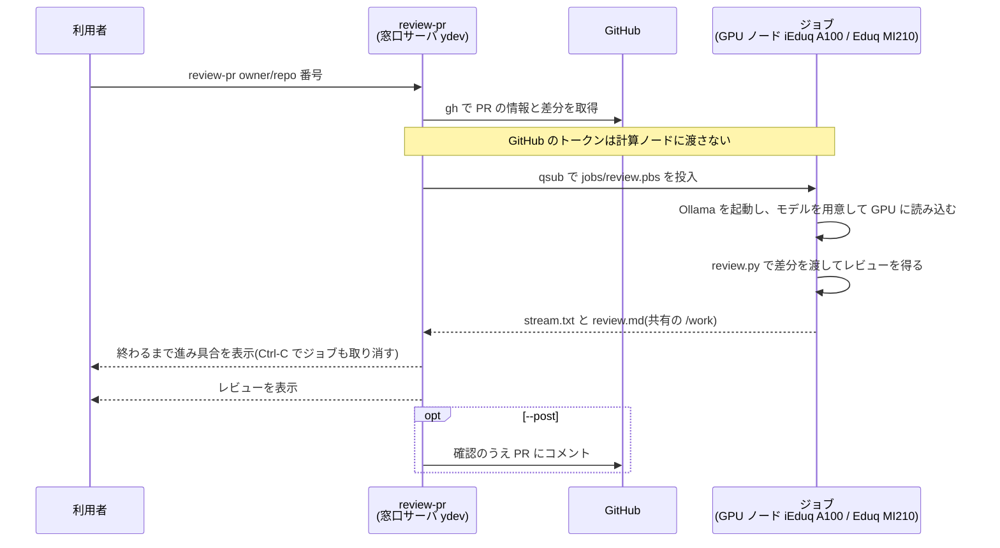
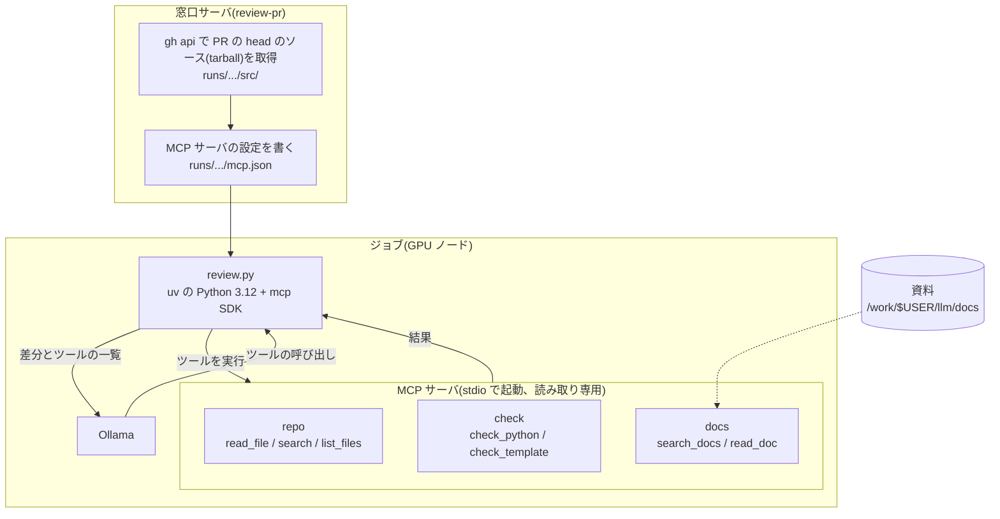

# mikawa-pbl-localllm-review

豊橋技科大 HPC の GPU でローカル LLM を動かし、GitHub の PR をレビューする CLI。
`iEduq`(NVIDIA A100)と `Eduq`(AMD MI210)のどちらでも動く。

```bash
./review-pr TechnoTUT/dmxctl 3
./review-pr https://github.com/TechnoTUT/dmxctl/pull/3
```

## 仕組み



結果は `runs/<owner>_<repo>/pr<番号>-<日時>/` に残る。

| ファイル | 中身 |
|---|---|
| `review.md` | レビュー |
| `src/` / `mcp.json` | `--mcp` のとき: PR 適用後のソース / MCP サーバの設定 |
| `pr.json` / `pr.diff` | PR の情報と差分 |
| `progress` | ジョブの進み具合 |
| `stream.txt` / `stream.txt.stat` | 生成途中の出力 / 段階とトークン数 |
| `job.log` / `ollama.log` | ジョブと Ollama のログ |

## 初回セットアップ(窓口サーバで 1 回だけ)

```bash
# gh(管理者権限なしで ~/.local/bin に導入済み)のログイン
gh auth login

# Ollama を /work/$USER/llm に展開(約 1.4GB)
mkdir -p /work/$USER/llm/ollama && cd /work/$USER/llm
curl -fL -o ollama-linux-amd64.tar.zst \
  https://github.com/ollama/ollama/releases/download/v0.40.13/ollama-linux-amd64.tar.zst
tar --use-compress-program=zstd -xf ollama-linux-amd64.tar.zst -C ollama

# Eduq(AMD MI210)でも使う場合は、AMD(ROCm)版のライブラリを同じ場所に追加で展開する(約 1GB)
curl -fL -o ollama-linux-amd64-rocm.tar.zst \
  https://github.com/ollama/ollama/releases/download/v0.40.13/ollama-linux-amd64-rocm.tar.zst
tar --use-compress-program=zstd -xf ollama-linux-amd64-rocm.tar.zst -C ollama
```

モデル(既定 `flint:40b`、約 23GB)は初回のジョブの中で `/work/$USER/llm/models` に取得され、以降は使い回される。

## 使い方

```
review-pr [オプション] <owner/repo> <PR番号>
review-pr [オプション] <PR の URL>
review-pr [オプション] <owner/repo>  (PR などを対話モードで選ぶ)
review-pr                       (引数なし: 対話モードで順に選ぶ)

  -i, --interactive    対話モードで選ぶ(引数やオプションで指定した値が既定値になる)
  -q, --queue QUEUE    使うキュー: iEduq(NVIDIA A100、既定)か Eduq(AMD MI210)
  -g, --gpus N         使う GPU 数(iEduq は 1、Eduq は 1〜2。既定 1)
  -H, --host NODE      ノードを固定する(例 yind01)
  -m, --model MODEL    Ollama のモデル(既定 flint:40b)
  -o, --output FILE    レビューを FILE にも保存する
      --mcp            モデルが MCP のツールでリポジトリを読み、検査し、資料を引けるようにする(後述)
      --scope DIR      --mcp のツールが読めるのを、リポジトリの DIR の中だけにする(例 teams/invtechno)
      --post           レビューを PR にコメントとして投稿する(投稿前に確認する)
      --no-wait        ジョブを投入したら待たずに終わる
      --quiet          生成途中の出力を流さず、状態表示だけにする
      --new-job        レビューサーバが動いていても、新しいジョブで実行する
      --server         レビューサーバで実行する(動いていなければエラー)
      --start-server   レビューサーバが動いていなければ起動し(最長 8 時間)、モデルの読み込みを待ってから依頼する
```

進み具合は標準エラーに、レビュー本文は標準出力に出るので、`> review.md` で本文だけ保存できる。

### 対話モード

引数なしで実行すると、リポジトリを入力した後、次の項目を矢印キーか Vim のキーで選ぶ。
`./review-pr TechnoTUT/dmxctl` のようにリポジトリだけを指定すると、PR の選択から始まる。

- PR(オープンな PR の一覧。「その他」で番号を入力すれば、マージ済みの PR なども指定できる)
- キューと GPU(iEduq × 1、Eduq × 1、Eduq × 2)
- モデル(取得済みの一覧。「その他」で名前を入力できる)
- ノード(自動か固定)、PR に投稿するか、終わるまで待つか

| キー | 動き |
|---|---|
| `↑` / `k`、`↓` / `j` | 上下に移動 |
| `g` / `G` | 先頭 / 末尾へ |
| `1`〜`9` | その番号の選択肢へ |
| Enter | 決定 |
| `q`(または Ctrl-C) | 中止 |

最後に同じ内容を引数で指定するコマンドを表示し、確認してから実行する。
`-i` を付けると、引数やオプションで指定した値を既定値にして対話モードに入る。

```
$ ./review-pr
Repository (owner/repo): TechnoTUT/dmxctl
Pull request: #4  リファクタリング: engine.rs / ui_map.rs の分割と clippy 対応  (dodolia907, +2661/-2428)
Queue / GPU  (↑↓ / j k to move, Enter to select, q to cancel)
  iEduq  NVIDIA A100 80GB x1 (yind00/01)
> Eduq   AMD MI210 64GB x1 (ysnd00/01)
  Eduq   AMD MI210 64GB x2 (ysnd00/01; for models over 64GB, no speedup for models that fit on one)
```

### 実行中の表示

ジョブを待つ間、画面の一番下に Claude Code 風の状態表示の行を出す。
考える過程(thinking)は、そのすぐ上の高さを固定した枠(既定 5 行)の中で、最新の行だけを入れ替えて薄い色で見せる。
画面は流れない。レビュー本文・ツールの呼び出し・見出しは、枠の上に確定して流す。

```
Reviewing the diff (12,345 chars)
Tool: repo__read_file {"path": "teams/invtechno/docs/api.md"} -> teams/invtechno/docs/api.md (lines 1-194 of 194)
── thinking ──
  The doc says required credits total 12, but category A is 4 and B is 6 ...
  So 4 + 6 = 10, which does not match the total. Let me check the example ...
  In the example response, overall.remaining_earned is 10 but the categories ...
  That is inconsistent too. I should flag it as high priority.
  Next, the error format: 400 and 404 return the
Deliberating… (2m 41s · ↓ 3.4k tokens · thinking · ctrl+c to cancel)
```

- 枠の行数は `--think-lines N` で変えられる(`0` で考える過程を出さない)。本文が始まると枠は消える
- 枠に収まらない長い行は、末尾(今書いている所)を見せる
- 状態表示の行は、経過時間・生成したトークン数・段階(queued → starting ollama → loading model onto gpu → reading diff → thinking → using tools → writing review)を示す。本文を書いている間は、末尾に生成途中の行を出す
- 先頭の言葉(Deliberating など)の上を明るいシアンの帯が流れる。言葉は段階が変わるたびに変わる
- 本文はすでに画面に流れているので、終わった後は保存先だけを表示する。標準出力をリダイレクトしたときは、本文を出力する
- `--quiet` を付けると、生成途中の出力を流さず、状態表示だけにする
- 端末でないとき(ログに保存するときなど)は、アニメーションの代わりに段階の変化を 1 行ずつ出し、考える過程もすべて流す
- CLI が表示する文言は英語。レビュー本文は日本語(`review.py` のプロンプトで指定)

### キュー

| キュー | ノード | GPU | 1 ジョブの上限 |
|---|---|---|---|
| `iEduq` | yind00, yind01 | NVIDIA A100 80GB × 1 | CPU 8、メモリ 64GB、8 時間。flint で約 56 トークン/秒 |
| `Eduq` | ysnd00, ysnd01 | AMD Instinct MI210 64GB × 2 | CPU 8、メモリ 64GB、GPU 2、8 時間。flint で約 30 トークン/秒 |

- どちらも同時実行は 1 人 1 ジョブ。2 つのキューは別々なので、iEduq と Eduq で 1 本ずつ同時に動かせる
- ジョブが保留(H)になると、`review-pr` はジョブを取り消して終わる。ノードの不調の可能性があるので、`-H` で別のノードを指定する

## レビューサーバ(モデルを載せたまま続けてレビューする)

`review-pr` を毎回ジョブとして実行すると、ジョブの開始から Ollama の起動・GPU の検出・モデルの読み込みまでに
iEduq で約 1 分 45 秒(Eduq で約 35 秒)かかり、さらにキューの順番待ちもある。
`review-server start` で常駐ジョブ(最長 8 時間)を立てておくと、モデルを GPU に載せたまま、
`review-pr` からの依頼を順にレビューする。2 件目からは数秒で生成が始まる(2026-11-03 の実測で 5.5 秒)。

```bash
./review-server start              # iEduq で 8 時間。モデルを読み込み終わるまで待つ(約 1〜2 分)
./review-server start -q Eduq -t 4 # Eduq で 4 時間
./review-server status             # 動いているサーバ、残り時間、実行中・待ちの依頼
./review-server stop               # 実行中のレビューを終えてから止める(--now ですぐ止める)

./review-pr TechnoTUT/dmxctl 3     # サーバが動いていれば自動でサーバに依頼する
./review-pr --new-job TechnoTUT/dmxctl 3   # サーバがあっても新しいジョブで実行する
./review-pr --start-server TechnoTUT/dmxctl 3   # サーバがなければ起動してから依頼する(-q でキューを選ぶ)
```

- 依頼は 1 件ずつ順に処理する。待っている間、状態表示の行に「waiting for the server (1 ahead)」のように前の件数を出す
- 対話モードでは、動いているサーバが「Where to run」の最初の選択肢になる。
  「Start a review server (up to 8h)」を選ぶと、サーバの動いていないキューから起動先を選べる(`--start-server` と同じ)
- `--start-server` でサーバを待っている間に Ctrl-C を押すと、その依頼だけをやめる。サーバは起動を続ける
- サーバと `review-pr` は共有の `/work` 上のファイル(`server/<ID>/`)でやりとりする。ポートは開けないので、
  ほかの利用者からは使えない
- 依頼したモデルが載っているものと違えば、サーバがそのモデルに切り替える
- 残り時間が足りない依頼はサーバが断り、`review-pr` は自動で新しいジョブに切り替える
- サーバも 1 ジョブとして数えるので、同じキューでは、サーバを動かしている間は別のジョブは順番待ちになる
  (`--new-job` は、もう一方のキューで使うとよい)

## MCP のツールを使う(--mcp)

`--mcp` を付けると、モデルがレビュー中に MCP のツールを呼べるようになる。差分だけでは判断できないこと
(変更された関数の呼び出し元、型や定数の定義、設定ファイルなど)をリポジトリのファイルを読んで確かめたり、
Python・HTML・Django テンプレートを検査したり、使っている版の公式資料で API の使い方を確かめたりできる。

| サーバ | ツール | 中身 |
|---|---|---|
| `repo` | `read_file` / `search` / `list_files` | PR 適用後のリポジトリを読む(行番号付き、1 回 400 行まで) |
| `check` | `check_python` | ruff で構文エラー・未定義の名前・使っていない import・bugbear の規則を調べる(書式の規則は使わない) |
| | `check_template` | HTML と Django テンプレートの、開きタグと閉じタグ・``〜`` などの対応を調べる |
| `docs` | `search_docs` / `read_doc` | Python・Django・HTML(MDN)の公式資料を検索して読む。検索は機能語(on・which など)を無視し、全部の語を含む節がなければ、含む語の多い順(珍しい語ほど重く)に出す。変更履歴(releases)より今の動作の説明を先に出す |

モデルには、Django・Python・HTML の動作を根拠にする指摘(CSRF・Cookie、フィールドの引数、テンプレートタグなど)は
記憶で書かず、`docs` で確かめて根拠の資料のパスを添えるよう指示している(確かめられなければ「要確認」)。
プロンプトのツールの説明は、起動したサーバの分だけ載せる(資料を取得していなければ `docs` の説明は載らない)。

`check` は PR のコードを実行しない(ファイルを読んで調べるだけ)。`manage.py check` やテストのように
コードを動かす検査は、計算ノードで学生のコードが動き、共有の `/home` にある gh の認証情報などに
触れられてしまうので入れていない。

資料は窓口サーバで 1 回取得しておく(約 25MB、`/work/$USER/llm/docs`)。取得していなければ `docs` は使わない:

```bash
./fetch-docs                               # Python 3.14、Django 6.1.2、HTML(MDN)
./fetch-docs --python 3.13 --django 5.2.8  # 別の版を足す
```

使う版は、レビューするリポジトリの `pyproject.toml`(`requires-python`、`django==`)や `requirements*.txt` から選ぶ
(合う版がなければ取得済みの最も新しい版)。Django を使っていないリポジトリでは Django の資料を渡さない。

```bash
./review-pr --mcp TechnoTUT/dmxctl 3
```



モデルがツールを呼ぶたびに review.py が MCP サーバで実行して結果を返し、答えが出るまで繰り返す。

- どのツールも読み取り専用で、`src/`(と資料)の外は読めない
- 1 パートあたり最大 12 回まで呼べる(結果の末尾に残りの回数を添える)。超えたらツールなしで書かせる。
  そのうちリポジトリを読む `repo__*` は 6 回まで(`check`・`docs` もあるとき。`review.py` の `MAX_REPO_CALLS`)。
  使い切ったら `repo__*` をツールの一覧から外し、それでも呼ばれたら実行せずに断る。
  プロンプトで「読み回らない」と伝えるだけでは、チームの文書を片端から読み、資料で確かめる回数が残らなかった
  呼んだツールは画面に薄い色で 1 行ずつ出る
- 変更されたファイルに共通するフォルダ(例 `teams/invtechno`)をプロンプトで伝え、ほかのフォルダを読み回らないよう指示する。
  モノレポでは、制限しないとチームの資料を片端から読み、考える過程も長くなる
  (pbl-app-2026 #49 では、Markdown 2 ファイルの PR で 32 回呼び、考える過程が 1.9 万トークンを超えた)
- ソースは窓口サーバで取得するので、gh のトークンは計算ノードに渡さない
- 公式の mcp SDK(Python 3.10 以上)を使うため、uv で Python 3.12 と `mcp==2.3.0`、`ruff==0.17.3` の環境を用意する
  (`jobs/run_review.sh`)。窓口サーバで取得してキャッシュ(`~/.cache/uv`)に入れ、ジョブはネットワークを使わない
- ツールの結果の分だけ入力が増え、時間もかかる(ジョブの時間上限はパートごとに 15 分延ばす)
- ツール呼び出しに対応したモデルが必要(`flint:40b` は対応)

### 読める範囲を制限する(--scope)

モノレポで 1 チームだけを対象にするときは、`--scope` でツールが読めるフォルダを決める(`--mcp` も有効になる):

```bash
./review-pr --scope teams/invtechno https://github.com/mikawa-pbl/pbl-app-2026/pull/49
./review-pr --scope teams/invtechno,teams/mint ...   # カンマで複数
```

- `repo` と `check` は、範囲の外のパスを拒否する(`..`、絶対パス、範囲の外を指すシンボリックリンクも)。
  `path` を省略すると範囲のフォルダが対象になり、`teams` のような上のフォルダを指定すると、その中の範囲だけを調べる
- プロンプトでも「対象はこの中だけ」と伝える
- 共通の設定(`pbl_project/settings.py` など)も読めなくなる。それも見せたいときは `--scope` に加える
- `docs`(公式資料)は対象外(リポジトリではないため)

### ほかの MCP サーバを足す

リポジトリ直下に `mcp.json` を置くと、そのサーバも使う。形は Claude Code の `.mcp.json` と同じ。
サーバは計算ノードで起動される。文字列の中の `${PYTHON}`(mcp SDK 入りの Python)、`${ROOT}`、`${RUN_DIR}` は置き換えられる。

```json
{"mcpServers": {
  "docs": {"command": "${PYTHON}", "args": ["/work/you/my_docs_server.py"]},
  "wiki": {"type": "http", "url": "https://example.com/mcp"}
}}
```

- HTTP のサーバは計算ノードから届く URL にする(ヘッダによる認証には対応していない)
- uv はジョブの中では `--offline` で動くので、追加のサーバに必要なパッケージは事前に用意しておく
- 追加のサーバのツールも「サーバ名__ツール名」でモデルに見せる。書き込みのできるツールは足さない

## モデルの選び方

PR #3(CI の変更、差分 99 行)で、指摘を差分と照らし合わせて比べた結果(2026-11-03、iEduq):

| モデル | 正しい指摘 | 誤った指摘 | 時間 |
|---|---|---|---|
| qwen3-coder:30b | 0 | 2 | 19 秒 |
| qwen3.8:27b-q8_0 | 3 | 0 | 243 秒 |
| muse-glimmer:30b-q8_0 | 4 | 2 | 181 秒 |
| **flint:40b**(既定) | **5** | **0** | 274 秒 |
| ornith-1.5:35b | 5 | 1 | 412 秒 |

PR 1 件だけでの比較なので、別の PR でも比べるとよい。同じ PR を別のモデルでレビューするには `-m` で指定する:

```bash
./review-pr -m qwen3.8:27b-q8_0 TechnoTUT/dmxctl 3
```

## 制約と注意

- 差分は約 16 万文字で打ち切る(コンテキスト長 131072 トークン)。打ち切られた後ろのファイルはレビューされない
- 考える過程は 1 回のリクエストで 8,000 トークンまで(`review.py` の `THINK_LIMIT`)。超えたら打ち切り、
  それまでの考える過程を「検討メモ」として渡して、考える過程なしで本文を書かせる。
  同じ指摘の見直しを繰り返して本文になかなか進まない(pbl-app-2026 #49 で 2 万トークン超)のを防ぐ
- レビューは誤りを含むことがある。`--post` で投稿するときは、内容を確かめてから投稿する
- gh の認証情報は窓口サーバでだけ使う(計算ノードには PR の情報と差分だけを渡す)

## ファイル

| ファイル | 役割 |
|---|---|
| `review-pr` | CLI。PR の取得、ジョブの投入(またはサーバへの依頼)と待機、結果の表示と投稿 |
| `review-server` / `jobs/server.pbs` | レビューサーバの起動・状態確認・停止 / 常駐ジョブ |
| `jobs/server_common.sh` | サーバの一覧と生死の判定 |
| `motd` | `review-pr` の起動時に表示するバナー(端末に出すときだけ) |
| `jobs/ui.sh` | 色の設定と、対話用の入力・メニュー(`review-pr` と `review-server` で共通) |
| `review.py` | Ollama にプロンプトを渡してレビューを得る(`--mcp-config` なしなら標準ライブラリのみ) |
| `mcp_client.py` | MCP サーバにつなぎ、ツールを Ollama のツール呼び出しから使えるようにする |
| `mcp_repo_server.py` | PR 適用後のリポジトリを読み取り専用で返す MCP サーバ |
| `mcp_check_server.py` | Python(ruff)と HTML・Django テンプレートを静的に検査する MCP サーバ |
| `mcp_docs_server.py` | Python・Django・HTML の公式資料を検索する MCP サーバ |
| `mcp_scope.py` | `repo` と `check` が読める範囲(`--scope`)の判定 |
| `fetch-docs` | `mcp_docs_server.py` が使う資料を取得する |
| `jobs/run_review.sh` | review.py の実行(mcp.json があれば uv の環境で MCP を使う) |
| `jobs/review.pbs` | レビューのジョブ |
| `jobs/ollama_env.sh` | Ollama の起動、モデルの取得、GPU への読み込みの確認 |
| `jobs/qsub_common.sh` | キューに応じた qsub の引数(コンテナ・GPU 数・ノード) |
