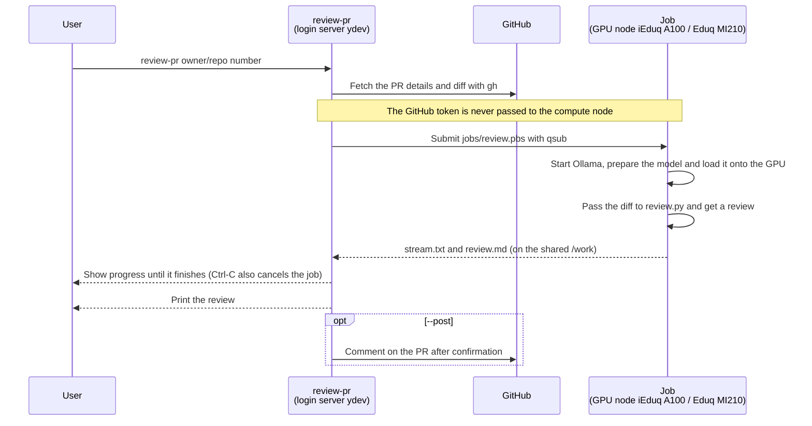
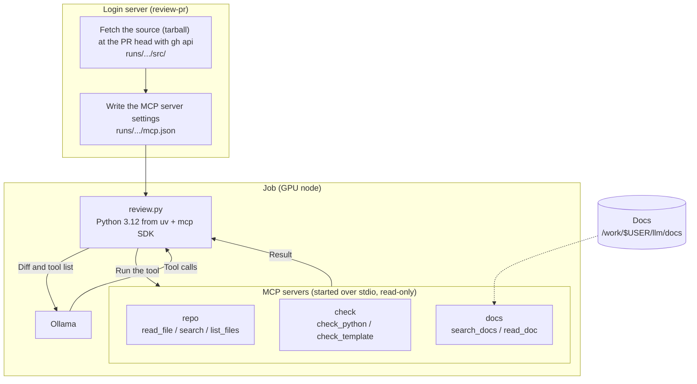
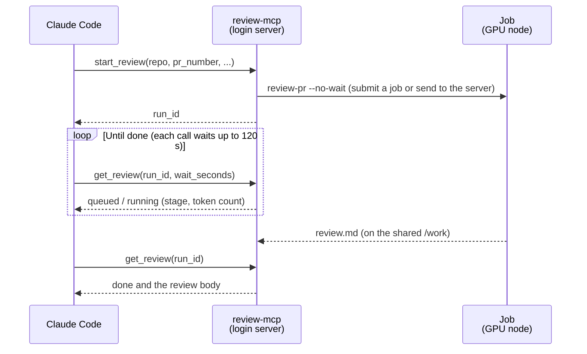

# mikawa-pbl-localllm-review

A CLI that reviews GitHub pull requests with a local LLM running on the GPUs of the Toyohashi University of Technology HPC.
It works on both `iEduq` (NVIDIA A100) and `Eduq` (AMD MI210).

```bash
./review-pr TechnoTUT/dmxctl 3
./review-pr https://github.com/TechnoTUT/dmxctl/pull/3
```

## How it works



Results are kept in `runs/<owner>_<repo>/pr<number>-<datetime>/`.

| File | Contents |
|---|---|
| `review.md` | The review |
| `src/` / `mcp.json` | With `--mcp`: the source with the PR applied / MCP server settings |
| `pr.json` / `pr.diff` | PR details and diff |
| `progress` | Job progress |
| `stream.txt` / `stream.txt.stat` | Output while generating / stage and token count |
| `job.log` / `ollama.log` | Job and Ollama logs |

## First-time setup (once, on the login server)

```bash
# Log in to gh (installed in ~/.local/bin without admin rights)
gh auth login

# Extract Ollama into /work/$USER/llm (about 1.4GB)
mkdir -p /work/$USER/llm/ollama && cd /work/$USER/llm
curl -fL -o ollama-linux-amd64.tar.zst \
  https://github.com/ollama/ollama/releases/download/v0.40.13/ollama-linux-amd64.tar.zst
tar --use-compress-program=zstd -xf ollama-linux-amd64.tar.zst -C ollama

# To also use Eduq (AMD MI210), extract the AMD (ROCm) libraries into the same place (about 1GB)
curl -fL -o ollama-linux-amd64-rocm.tar.zst \
  https://github.com/ollama/ollama/releases/download/v0.40.13/ollama-linux-amd64-rocm.tar.zst
tar --use-compress-program=zstd -xf ollama-linux-amd64-rocm.tar.zst -C ollama
```

The model (default `flint:40b`, about 23GB) is pulled into `/work/$USER/llm/models` during the first job and reused afterwards.

## Usage

```
review-pr [options] <owner/repo> <PR number>
review-pr [options] <PR URL>
review-pr [options] <owner/repo>  (choose the PR and the rest interactively)
review-pr                       (no arguments: choose everything interactively)

  -i, --interactive    Choose interactively (values given as arguments or options become the defaults)
  -q, --queue QUEUE    Queue to use: iEduq (NVIDIA A100, default) or Eduq (AMD MI210)
  -g, --gpus N         Number of GPUs (1 on iEduq, 1-2 on Eduq; default 1)
  -H, --host NODE      Pin the node (e.g. yind01)
  -m, --model MODEL    Ollama model (default flint:40b)
  -o, --output FILE    Also save the review to FILE
      --mcp            Let the model read the repository, run checks and look up docs with MCP tools (see below)
      --scope DIR      Limit what the --mcp tools can read to DIR in the repository (e.g. teams/invtechno)
      --post           Post the review as a PR comment (asks for confirmation first)
      --no-wait        Exit right after submitting the job
      --quiet          Show only the status line, not the output while generating
      --new-job        Run in a new job even if a review server is running
      --server         Run on the review server (error if none is running)
      --start-server   Start a review server if none is running (up to 8 hours), wait for the model to load, then send the request
```

Progress goes to stderr and the review body to stdout, so `> review.md` saves just the body.

### Interactive mode

Run without arguments, enter the repository, then choose each of the following with the arrow keys or Vim keys.
Give only the repository, as in `./review-pr TechnoTUT/dmxctl`, to start from choosing the PR.

- PR (list of open PRs; choose "Other" and enter a number to pick a merged PR or the like)
- Queue and GPUs (iEduq × 1, Eduq × 1, Eduq × 2)
- Model (list of pulled models; choose "Other" to enter a name)
- Node (automatic or pinned), whether to post to the PR, whether to wait until it finishes

| Key | Action |
|---|---|
| `↑` / `k`, `↓` / `j` | Move up / down |
| `g` / `G` | Go to first / last |
| `1`-`9` | Go to that option |
| Enter | Select |
| `q` (or Ctrl-C) | Cancel |

At the end it shows the equivalent command with arguments and runs it after confirmation.
With `-i`, interactive mode starts with the values given as arguments or options as defaults.

```
$ ./review-pr
Repository (owner/repo): TechnoTUT/dmxctl
Pull request: #4  リファクタリング: engine.rs / ui_map.rs の分割と clippy 対応  (dodolia907, +2661/-2428)
Queue / GPU  (↑↓ / j k to move, Enter to select, q to cancel)
  iEduq  NVIDIA A100 80GB x1 (yind00/01)
> Eduq   AMD MI210 64GB x1 (ysnd00/01)
  Eduq   AMD MI210 64GB x2 (ysnd00/01; for models over 64GB, no speedup for models that fit on one)
```

### Display while running

While waiting for the job, a Claude Code-style status line sits at the bottom of the screen.
The thinking is shown in a dim color in a fixed-height box just above it (5 lines by default), where only the newest lines are swapped in.
The screen does not scroll for it. The review body, tool calls and headings are committed above the box and scroll up.

```
Reviewing the diff (12,345 chars)
Tool: repo__read_file {"path": "teams/invtechno/docs/api.md"} -> teams/invtechno/docs/api.md (lines 1-194 of 194)
── thinking ──
  The doc says required credits total 12, but category A is 4 and B is 6 ...
  So 4 + 6 = 10, which does not match the total. Let me check the example ...
  In the example response, overall.remaining_earned is 10 but the categories ...
  That is inconsistent too. I should flag it as high priority.
  Next, the error format: 400 and 404 return the
Deliberating… (2m 41s · ↓ 3.4k tokens · thinking · ctrl+c to cancel)
```

- Change the box height with `--think-lines N` (`0` hides the thinking). The box disappears once the body starts
- Lines too long for the box show their end (where it is currently writing)
- The status line shows the elapsed time, the number of tokens generated and the stage (queued → starting ollama → loading model onto gpu → reading diff → thinking → using tools → writing review). While the body is being written, the line being generated is shown at the end
- A bright cyan band sweeps across the leading word (Deliberating, etc.). The word changes with each stage
- Since the body has already scrolled by, only the save location is shown at the end. When stdout is redirected, the body is written there
- With `--quiet`, the output while generating is not shown, only the status line
- When not on a terminal (e.g. when saving to a log), stage changes are printed one per line instead of the animation, and all of the thinking is printed
- The CLI's messages are in English. The review body is in Japanese (specified in the prompt in `review.py`)

### Queues

| Queue | Nodes | GPU | Per-job limits |
|---|---|---|---|
| `iEduq` | yind00, yind01 | NVIDIA A100 80GB × 1 | 8 CPUs, 64GB memory, 8 hours. About 56 tokens/s with flint |
| `Eduq` | ysnd00, ysnd01 | AMD Instinct MI210 64GB × 2 | 8 CPUs, 64GB memory, 2 GPUs, 8 hours. About 30 tokens/s with flint |

- Each queue allows one running job per user. The two queues are separate, so you can run one job on iEduq and one on Eduq at the same time
- If a job goes on hold (H), `review-pr` cancels it and exits. The node may be unhealthy, so pin another node with `-H`

## Review server (keep the model loaded for consecutive reviews)

Running `review-pr` as a new job each time takes about 1 min 45 s on iEduq (about 35 s on Eduq) from job start
through starting Ollama, detecting the GPU and loading the model, on top of waiting in the queue.
`review-server start` launches a resident job (up to 8 hours) that keeps the model on the GPU
and reviews requests from `review-pr` in turn. From the second request on, generation starts within seconds (5.5 s measured on 2026-11-03).

```bash
./review-server start              # 8 hours on iEduq. Waits until the model is loaded (about 1-2 min)
./review-server start -q Eduq -t 4 # 4 hours on Eduq
./review-server status             # Running servers, time left, running and queued requests
./review-server stop               # Stop after the running review finishes (--now to stop immediately)

./review-pr TechnoTUT/dmxctl 3     # Sends the request to the server automatically if one is running
./review-pr --new-job TechnoTUT/dmxctl 3   # Runs in a new job even if a server is running
./review-pr --start-server TechnoTUT/dmxctl 3   # Starts a server if none is running, then sends the request (choose the queue with -q)
```

- Requests are processed one at a time. While waiting, the status line shows how many are ahead, e.g. "waiting for the server (1 ahead)"
- In interactive mode, a running server is the first option under "Where to run".
  Choosing "Start a review server (up to 8h)" lets you pick a queue with no server running to start one (same as `--start-server`)
- Pressing Ctrl-C while `--start-server` is waiting for the server cancels only that request. The server keeps starting
- The server and `review-pr` communicate through files on the shared `/work` (`server/<ID>/`). No port is opened,
  so other users cannot use it
- If the requested model differs from the loaded one, the server switches to that model
- The server rejects requests that would not fit in the remaining time, and `review-pr` automatically falls back to a new job
- The server counts as a job, so while it runs, other jobs on the same queue wait their turn
  (use `--new-job` on the other queue)

## Using MCP tools (--mcp)

With `--mcp`, the model can call MCP tools during the review. It can read files in the repository to check things
the diff alone cannot settle (callers of a changed function, type and constant definitions, config files, etc.),
check Python, HTML and Django templates, and confirm API usage in the official docs for the version in use.

| Server | Tools | What they do |
|---|---|---|
| `repo` | `read_file` / `search` / `list_files` | Read the repository with the PR applied (with line numbers, up to 400 lines per call) |
| `check` | `check_python` | Check for syntax errors, undefined names, unused imports, bugbear rules, `== None` / `== True`, `type()` comparisons and bare `except` with ruff (no formatting or naming rules) |
| | `check_template` | Check that HTML and Django templates have matching open and close tags, ``…``, etc. |
| `docs` | `search_docs` / `read_doc` | Search and read the official Python, Django and HTML (MDN) docs. The search ignores function words (on, which, etc.); if no section contains every word, results are ranked by how many words they contain (rarer words weigh more). Descriptions of current behaviour come before changelogs (releases) |

The model is told not to write findings that rest on Django, Python or HTML behaviour (CSRF and cookies, field arguments,
template tags, etc.) from memory, but to check them with `docs` and cite the path of the doc it relied on (or mark them "needs checking" if it cannot confirm).
The prompt only describes the tools of servers that were started (if the docs have not been fetched, `docs` is not described).

`check` does not run the PR's code (it only reads and inspects files). Checks that run code, such as `manage.py check` or tests,
are left out because students' code would run on the compute node and could reach things like the gh credentials
on the shared `/home`.

Fetch the docs once on the login server (about 25MB, into `/work/$USER/llm/docs`). If they have not been fetched, `docs` is not used:

```bash
./fetch-docs                               # Python 3.14, Django 6.1.2, HTML (MDN)
./fetch-docs --python 3.13 --django 5.2.8  # Add other versions
```

The version is chosen from the reviewed repository's `pyproject.toml` (`requires-python`, `django==`) or `requirements*.txt`
(the newest fetched version if none matches). Repositories that do not use Django are not given the Django docs.

```bash
./review-pr --mcp TechnoTUT/dmxctl 3
```



Each time the model calls a tool, review.py runs it on the MCP server and returns the result, repeating until the model gives an answer.

- Every tool is read-only and cannot read outside `src/` (and the docs)
- Up to 12 calls per part (the number left is appended to each result). After that the model must write without tools.
  Of those, the `repo__*` tools that read the repository are limited to 6 (when `check` and `docs` are also available; `MAX_REPO_CALLS` in `review.py`).
  Once used up, `repo__*` is removed from the tool list, and calls that still come in are refused without running.
  Only telling it "don't wander around reading" in the prompt left it reading the team's documents one after another, with no calls left to check the docs.
  Each tool call is shown on screen as one dim line
- The prompt names the folder common to the changed files (e.g. `teams/invtechno`) and tells the model not to wander through other folders.
  In a monorepo, without this limit it reads the teams' documents one after another and the thinking grows long too
  (on pbl-app-2026 #49, a PR touching two Markdown files, it made 32 calls and the thinking exceeded 19,000 tokens)
- The source is fetched on the login server, so the gh token is never passed to the compute node
- To use the official mcp SDK (Python 3.10+), an environment with Python 3.12, `mcp==2.3.0` and `ruff==0.17.3` is prepared with uv
  (`jobs/run_review.sh`). It is downloaded on the login server and cached (`~/.cache/uv`), so the job does not use the network
- Tool results add to the input and take more time (the job time limit is extended by 15 minutes per part)
- The model must support tool calling (`flint:40b` does)

### Limiting what can be read (--scope)

To target just one team in a monorepo, set the folders the tools can read with `--scope` (this also enables `--mcp`):

```bash
./review-pr --scope teams/invtechno https://github.com/mikawa-pbl/pbl-app-2026/pull/49
./review-pr --scope teams/invtechno,teams/mint ...   # Comma-separated for several
```

- `repo` and `check` reject paths outside the scope (including `..`, absolute paths and symlinks pointing outside it).
  Omitting `path` targets the scope folders, and giving a parent folder such as `teams` inspects only the scoped parts inside it
- The prompt also says "only these folders are in scope"
- Shared settings (such as `pbl_project/settings.py`) become unreadable too. Add them to `--scope` if you want them visible
- `docs` (the official docs) is not affected, since it is not the repository

### Adding other MCP servers

Put a `mcp.json` at the repository root to use its servers as well. The format is the same as Claude Code's `.mcp.json`.
The servers are started on the compute node. `${PYTHON}` (a Python with the mcp SDK), `${ROOT}` and `${RUN_DIR}` in strings are substituted.

```json
{"mcpServers": {
  "docs": {"command": "${PYTHON}", "args": ["/work/you/my_docs_server.py"]},
  "wiki": {"type": "http", "url": "https://example.com/mcp"}
}}
```

- HTTP servers must use a URL reachable from the compute node (authentication via headers is not supported)
- uv runs with `--offline` inside the job, so prepare any packages the extra servers need in advance
- Tools of extra servers are also shown to the model as "server name__tool name". Do not add tools that can write

## Using it from other Claude Code sessions (MCP server)

Register `review-mcp` as an MCP server (stdio), and other Claude Code sessions can ask things like "review PR #49".
No port is opened on the login server, so Claude Code starts the server as a child process.

```bash
# From Claude Code on the login server (ydev)
claude mcp add llm-review -- /work/$USER/mikawa-pbl-localllm-review/review-mcp

# From Claude Code on another machine (ydev is the name given to the login server in ~/.ssh/config; needs a key that does not prompt for a password)
claude mcp add llm-review -- ssh ydev /work/<username>/mikawa-pbl-localllm-review/review-mcp
```

Add `--scope user` to use it from any directory.



| Tool | What it does |
|---|---|
| `start_review` | Request a review of a PR and return a `run_id`. `model`, `queue`, `use_tools` (`--mcp`), `scope` and `new_job` can be set |
| `get_review` | The state (queued / running / done / failed) and, if done, the review body. Can wait up to `wait_seconds` (max 120) for it to finish |
| `list_reviews` | Recent reviews and their states |
| `cancel_review` | Cancel a queued or running review |
| `list_pull_requests` | List a repository's PRs (to pick one to review) |
| `server_status` | Review server status (`review-server status`) |

- Internally it just calls `review-pr --no-wait`, so the request goes to a review server if one is running
- It does not post comments to the PR. To post, the caller confirms with the user and then uses `gh`
- A review takes 5-10 minutes. If the tool times out in Claude Code, lower `wait_seconds`
  or raise the `MCP_TOOL_TIMEOUT` environment variable (milliseconds)

## Choosing a model

Results of checking each model's findings against the diff of PR #3 (a CI change, 99-line diff) (2026-11-03, iEduq):

| Model | Correct findings | Wrong findings | Time |
|---|---|---|---|
| qwen3-coder:30b | 0 | 2 | 19 s |
| qwen3.8:27b-q8_0 | 3 | 0 | 243 s |
| muse-glimmer:30b-q8_0 | 4 | 2 | 181 s |
| **flint:40b** (default) | **5** | **0** | 274 s |
| ornith-1.5:35b | 5 | 1 | 412 s |

This compares only one PR, so it is worth comparing on other PRs too. To review the same PR with another model, pass it with `-m`:

```bash
./review-pr -m qwen3.8:27b-q8_0 TechnoTUT/dmxctl 3
```

## Limitations and caveats

- The diff is truncated at about 160,000 characters (context length 131072 tokens). Files after the cut are not reviewed
- Thinking is limited to 8,000 tokens per request (`THINK_LIMIT` in `review.py`). Beyond that it is cut off,
  the thinking so far is passed back as "review notes", and the model writes the body without thinking.
  This stops it from re-examining the same findings over and over without getting to the body (over 20,000 tokens on pbl-app-2026 #49)
- Reviews may contain mistakes. When posting with `--post`, check the content before posting
- gh credentials are used only on the login server (compute nodes receive only the PR details and diff)

## Files

| File | Role |
|---|---|
| `review-pr` | The CLI. Fetches the PR, submits the job (or sends a request to the server) and waits, shows and posts the result |
| `review-server` / `jobs/server.pbs` | Start, check and stop the review server / the resident job |
| `jobs/server_common.sh` | Listing servers and checking whether they are alive |
| `motd` | Banner shown when `review-pr` starts (only on a terminal) |
| `jobs/ui.sh` | Color settings and interactive prompts and menus (shared by `review-pr` and `review-server`) |
| `review.py` | Sends the prompt to Ollama and gets the review (standard library only without `--mcp-config`) |
| `mcp_client.py` | Connects to MCP servers and makes their tools available to Ollama's tool calling |
| `mcp_repo_server.py` | MCP server that serves the repository with the PR applied, read-only |
| `mcp_check_server.py` | MCP server that statically checks Python (ruff) and HTML / Django templates |
| `mcp_docs_server.py` | MCP server that searches the official Python, Django and HTML docs |
| `mcp_scope.py` | Decides what `repo` and `check` may read (`--scope`) |
| `fetch-docs` | Fetches the docs used by `mcp_docs_server.py` |
| `review-mcp` / `mcp_review_server.py` | MCP server that lets other Claude Code sessions use this review CLI |
| `jobs/run_review.sh` | Runs review.py (with MCP in the uv environment if mcp.json exists) |
| `jobs/review.pbs` | The review job |
| `jobs/ollama_env.sh` | Starting Ollama, pulling the model and confirming it is loaded onto the GPU |
| `jobs/qsub_common.sh` | qsub arguments for each queue (container, GPU count, node) |
